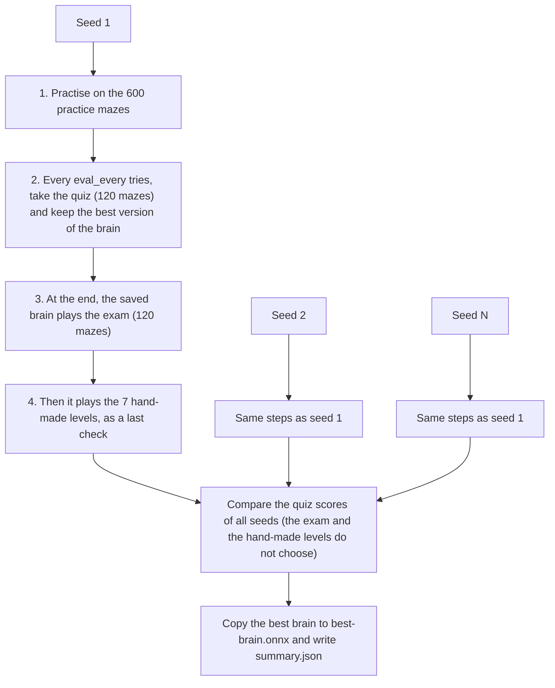

# How training works

A "brain" is a small program that moves a dot through a maze to the exit. You train a brain by
letting the dot play the maze many times and giving it points for good and bad moves. This page
explains the two ways we train. Both give the same kind of file (`.onnx`), so both brains run in the
arena in the same way.

```sh
uv run minotaurus train --config data/examples/qtable-brain.json
uv run minotaurus train --config data/examples/dqn-brain.json
```

## What the brain sees and what it does

- **What it sees:** the dot does not see the whole maze. It sees a square of 5 x 5 cells around
  itself. The game turns that square into a list of **77 numbers**:
  - 25 numbers say which cells are walls (`1` = wall, `0` = free),
  - 25 numbers say which cell is the exit (`1` = exit, `0` = not),
  - 25 numbers say how often the dot has been on each cell: `0` = never, `1` = once, `2` =
    twice, `3` = three times or more. A bump into a wall counts as one more time on the cell the
    dot is on (see "Getting out of the wall trap" below),
  - 2 numbers say which way the exit is (each is `-1`, `0` or `1`).
- **What it does:** it gives back **4 scores**, one for each move: up, down, left, right. The dot
  takes the move with the highest score.

Where 77 comes from: 25 cells x 3 kinds of information = 75, plus 2 for the exit direction = 77.
The code is `obs_size()` in `minotaurus/engine/observe.py`.

This is input version 1, the default. Version 2 (`"observation": {"version": 2}`) adds the last
move (4 numbers) and a bump flag (1), and the visit counts go up to 8: 82 numbers. See "Against
loops" below. The arena reads the version from the brain file, so both kinds run.

## Points

After every move the game gives the dot points. They are game rules, so they are not in the config
file (`minotaurus/engine/env.py`).

| What happens | Points |
|---|---|
| The dot reaches the exit | +1 |
| The dot takes a step | -0.01 |
| The dot hits a wall | -0.05 |

Every step costs a little, so a short way out ends with more points than a long way.

## How a training run goes

One **try** is one walk from the start until the dot reaches the exit or runs out of steps. Training
repeats the try many times. The number is `episodes` in the config. In every try, at every step:

1. **Look:** the game shows the dot what it sees now.
2. **Pick a move:** most of the time the move with the highest score. Sometimes a random move, so
   the dot keeps testing new things. At the start almost every move is random.
3. **Move:** the game makes the move and gives points.
4. **Learn:** the brain changes its scores using those points. The two ways of training differ here.

After many tries, the points from the exit spread backwards along the way to it. The random moves
become less frequent, so the dot uses more of what it has learned. The code is in
`minotaurus/trainer/train.py`.

## Way 1: Q-table (a table of scores)

A **table**. Each row is one thing the dot has seen (the 77 numbers), and next to it are 4 scores,
one for each move:

```
what the dot saw             up     down    left    right
view A  [0,1,0,0,1,...]      0.10   0.00    0.05    0.70
view B  [1,1,0,0,0,...]      0.00   0.30    0.00    0.00
```

The table starts empty. When the dot sees something new, a new row is added with all scores at 0.

**How it learns:** after a move, the score of that move is changed to match two things: the points
it just got, and the best score in the next row. So a move gets a high score when it gives points
now, or when it leads to a place with a high score. That is how the exit's +1 spreads backwards.

**Good:** simple and fast. You can open any row and see the 4 scores, so you can see why the dot
chose a move. On `easy-01` it reaches the exit every time (395 rows, 13 steps, the shortest way).

**Not so good:**
- Two different places in the maze can look the same to the dot, so they share one row.
- A bigger maze gives many more rows, so the table gets huge. It only suits small mazes.
- It knows nothing about something it has never seen.

Code: `minotaurus/trainer/qtable.py`. Settings: the `qtable` block of the config.

## Way 2: DQN (a small neural network)

A neural network is a formula with many numbers that can be adjusted. The 77 numbers go in, some
calculations happen in the middle, and 4 scores come out. There is no table. The network learns
patterns, so it can give good scores even for something it has never seen.

**How it learns:** it uses the same idea as the table (points now plus the best score next), but it
adjusts its formula numbers instead of table rows. Two things make this steadier:
- It remembers the last 20,000 steps and learns from a random handful of them each time, not only
  from the latest moves.
- It checks its answers against a frozen copy of itself, and refreshes that copy only now and then.

**Good:** it handles new places, so it can grow to bigger mazes.
**Not so good:** it is slower, has more settings, and its training can go up and down.

Code: `minotaurus/trainer/dqn.py`. Settings: the `dqn` block of the config.

## The training graph

When training ends, `train` draws `training.png` in the run folder. Switch it off with `--no-plot`.
Each panel shows how one number changes over the tries:

- **Success rate:** how often the dot reached the exit. It should climb to 1.0 (always).
- **Average steps per try:** it should fall towards the shortest way (13 steps on `easy-01`).
- **Average points per try:** it should rise, because short and clean walks score more.
- **Random-move rate:** it falls on purpose, so the dot trusts what it learned more over time.
- **Error:** how far off the brain's scores were. It should shrink and stay small.

Q-table on `easy-01` (3000 tries):


DQN on `easy-01` (600 tries). Notice the dip around try 180: neural network training can go up and
down before it settles.


## Settings and results

- A config file says which way to train, which levels, how many tries and which seed (the number
  that makes a run repeatable). Examples: `data/examples/`.
- The same seed gives the same training run.
- A run makes the folder `runs/<name>/<time>/` with:
  - `metrics.jsonl`: the average points, steps and success rate as training goes,
  - `training.png`: the graph of those numbers,
  - `checkpoints/`: saved copies from during training,
  - `config.json`: the settings used,
  - `brain.onnx`: the finished brain,
  - the bundle (`.tar`, or `.signed.tar` when you have a key): the brain with its settings and
    scores, the file to load in the arena,
  - `scores.json`: only with made mazes (below): how often the brain finishes the practice,
    check and test mazes.
  The `runs/` folder is not committed.
- When a run ends, the command prints a short summary: how long training took, how often the dot
  finished at the end, the average steps, the path length (1.00 is the shortest way) and the
  brain size.
- Check a brain: `uv run minotaurus check-brain <file.onnx>`.
- Watch a brain play: `uv run minotaurus play --brain <file.onnx>`.

## Mixed maze sizes and the hand-made levels

A brain trained on one maze size does not solve other sizes. In a test on 2026-11-24 a shaped DQN
trained on 9x9 mazes finished 90% of new 9x9 mazes but only 53% of 11x11, 33% of 13x13 and 10% of
17x17. So `generated` can mix sizes: `"sizes": [9, 11, 13, 17, 21]` splits every pile evenly over
those sizes (`size` must be one of them). `"border_exit": true` puts the exit in the outer wall, like
the hand-made levels. Example: `data/examples/dqn-mixed-brain.json` (sizes 9, 11 and 13, 600 practice,
120 check and 120 test mazes). A run of it on 2026-11-24 (4 seeds, 29 min) collapsed: it used the old
small recipe (64-64 network, `epsilon_decay` 0.99, 5000 tries), so random moves ended by try 300 and
no seed kept learning (best saved brain: 55% validation, from try 1000). The same mazes with the R3
recipe: `data/examples/dqn-mixed-learning-brain.json` (128-128 network, 15000 tries, `epsilon_decay`
0.997, replay 50000, wall mask, novelty bonus, patience 8, 4 seeds). Run on 2026-11-24 (20 min): no
collapse; validation 93 to 95%, test 82 to 94%, routes only 7 to 11% longer than the shortest, saved
at tries 2000 to 6250. The best seed finished 5 of the 7 hand-made levels (not hard-02, 21x21, nor
impossible-01, 41x41): it never trained above size 13. Next: `data/examples/dqn-mixed-wide-learning-brain.json`
(the same recipe on sizes 9, 11, 13, 17 and 21; 750 / 150 / 150 mazes). Run on 2026-11-24 (39 min):
all four seeds learned (71 to 82% wins at tries 500 to 1500; saved at try 1250 with 65 to 71%
validation, 65 to 69% test; hard-02 finished by one seed), then diverged at tries 1500 to 2500: the
loss went from 0.01 to between 12 and 4000 and wins fell to 0%; the early stop ended each run at
try 3250. Next: `data/examples/dqn-mixed-wide-stable-brain.json`, the same mazes and recipe with
`learning_rate` 0.0003 and `target_update` 1000 (a guess at a steadier run; not run yet). Size 9 has only
322 different mazes, which caps the piles.

Twelve of the test mazes (4 per size) are saved in `data/levels/test-mazes/` and show in the portal
as "Test maze ...". They are never used for training. Rewrite them with
`uv run python -m minotaurus.trainer.test_mazes` after changing that config (a test fails until then).

After training with made mazes, the brain also plays the six hand-made levels
(`fixed_levels.json`, and a line in the summary). That score is for you to read; it never decides
which seed is best (validation does).

## Several seeds at once

A seed is the number that sets a run's dice rolls, so each seed gives a slightly different brain.
Train several and keep the best:

```sh
uv run minotaurus train --config data/examples/dqn-shaped-brain.json --seeds 4 --parallel 4
```

- `--seeds 4` trains seeds 1 to 4 (counting up from the config `seed`), or put `"seeds": [1, 2, 3, 4]`
  in the config. The command option wins.
- `--parallel 4` runs that many at the same time, one per CPU core. Without it: one per core.
  The config can also have `"parallel": 4`.
- Output: `seed-<n>/` folders, `best-brain.onnx`, `summary.json` and a table of every seed.
- The best seed is chosen on the validation mazes (never the test mazes).

## Stop and stuck in the arena

The arena page has a **Stop** button: it ends the run (a manual run is not saved). The server
also ends a run by itself when the dot reaches no new square for 100 steps in a row: the result is
"Stuck" (a looping brain no longer plays on until the step limit). Levels with a step limit under
100 still time out first. The count is `STUCK_STEPS` in `minotaurus/server/arena.py`.

## Progress bar

On a terminal, `train` draws one line that updates in place: a bar, the percent, the try count and
the time left (worked out from the speed so far, so the first guesses are rough). With several
seeds it is one bar for all seeds plus "seeds done 1/4". When the output goes to a file or a pipe
the plain line per window is printed instead, and `metrics.jsonl` is the same either way.

## How several seeds are trained and chosen

**The four sets of mazes.** The step is the order each set is used in a run.

| Step | Set | Count | Where it comes from | Used for |
|---|---|---|---|---|
| 1 | Practice (train) | 600 | made by the generator in memory from the config, nothing saved | the brain learns on these |
| 2 | Quiz (validation) | 120 | the same, made in memory | every `eval_every` tries during training, it picks the best version of the brain |
| 3 | Exam (test) | 120 | the same, made in memory (12 of them are saved in `data/levels/test-mazes/` for the portal) | the final score, after training |
| 4 | Hand-made levels | 7 | files in `data/levels/`, designed by us | a last check after training; the brain never trains on them |

Steps 1 and 2 happen together while training runs. Steps 3 and 4 happen once at the end, on the
saved brain. The counts above are from `data/examples/dqn-mixed-brain.json`.

**Setup (once, before any seed starts):**

1. Read the config file: the maze size, how many mazes, and the number that fixes which mazes are made.
2. Make the mazes and split them into 3 piles: practice, quiz and exam. No maze is in two piles.

**Then, for the seeds you pick** (`--seeds 4` means seeds 1 to 4, or `seeds` in the config), the steps below run once per seed, at the same time, one CPU core each:



### The results table (several seeds)

`saved at` reads like `1250 of 3250`: the saved brain is the version from try 1250, out of the 3250
tries the run did (fewer than `episodes` when the early stop ended it). It is the try with the best
quiz (validation) score. On the same score the try with fewer loops wins, and on a full tie (same
score, same loops) the later try wins.
The `loops` column counts the quiz mazes the saved brain looped on. With made mazes, `path` is how the saved brain
plays the test mazes (steps divided by the shortest route, 1.0 is perfect; `-` when it finished
none). Without made mazes it is the last training window. The average steps are not in the table
(`summary.json` has them: they mix finished mazes with failed ones, which count their full step
limit, so they mostly repeat the test score). A line with a
warning sign names a seed whose last validation check fell below half of its saved brain's: training
got worse after the saved try, so the saved brain is an early one.

## Made mazes: practice, check and test

One hand-made maze is not a fair test: the brain can just learn that one maze by heart. With
`"levels": {"generated": {...}}` (example: `data/examples/qtable-generated.json`) the game makes many mazes
from a number and splits them into three piles:

- **practice (train):** the brain learns on these,
- **check (validation):** mazes it never practised on, to see if it really learned,
- **test:** more unseen mazes, for the final score.

No maze layout is in two piles. The same `maze_seed` always makes the same piles. After training,
`scores.json` shows the share of mazes finished in each pile. A big gap between practice and the
others means the brain learned the mazes by heart. A Q-table does exactly that today (about 90% on
practice and 0% on check and test), which is the reason for this feature.

### Keeping the best brain (on by default with made mazes)

A brain can get worse late in training (a DQN can suddenly forget). With made mazes, training
checks the brain on the check (validation) mazes every 250 tries and at the last try, and keeps
the best one: a higher score wins, on the same score the brain with fewer loops wins, and on a full
tie (same score, same loops) the later brain is kept (`minotaurus/trainer/train.py`, tested in
`tests/test_loops.py`). `minotaurus train` prints which try it kept, and
`metrics.jsonl` and the `.onnx` file record it. If no check finished a single maze, the final
brain is kept and a warning is printed. `"eval_every": 100` checks more often; `"eval_every": 0`
switches it off (the last brain is kept, as before).

### Size curriculum (experimental: it did not help)

With made mazes, `"stages": [5, 7, 9]` trains on small mazes first: the tries are split evenly
over the sizes, and the last size must be the maze `size` (the practice pile). The smaller sizes
use up to `train` practice mazes each; 5 x 5 has only 2 different mazes and 7 x 7 only 14.

It did **not** help. In the 2026-11-23 research (DQN, size 9, 3 seeds) two of three brains never
learned the size 9 mazes after the small ones, even with the best saved brain (8% or less on
check mazes); the plain set-up did better. Kept for further tests only.

## DQN on made mazes: what works (research 2026-11-23)

Full write-up with every table: [docs/research/2026-11-23-dqn-shaping.md](docs/research/2026-11-23-dqn-shaping.md).
Ready-made config: `data/examples/dqn-shaped-brain.json`.

- **A plain DQN learns nothing on made mazes:** the exit is too rare to find by chance (0% at
  size 9 and 11).
- **Reward shaping** (`"dqn": {"shaping": true}`): every training step also earns a little for
  getting closer to the exit and loses a little for moving away (measured by walking distance).
  Training only: scoring and the arena use the plain points. Size 9: 0% -> 69% on test (8 seeds).
  `"shaping_on_bump": false` skips it on a bump into a wall (experimental, no gain on check mazes).
- **Longer training tries** (`"train_step_limit_factor": 20`): training tries may last 20 x the
  shortest path instead of 4 x; scoring stays at 4 x. With shaping it made two of three brains
  collapse late, which keeping the best brain (above) repairs. Not needed with shaping alone.
- **Random moves when playing** (`"policy_epsilon": 0.1`): the brain makes 10% of its moves at
  random in the arena and in scoring, from a seeded random source, so a run can be replayed. A
  brain without memory gets stuck in loops; at size 9 this lifts test from 69% to 83%, but routes
  are 1.36 x the shortest. 0 (the default) changes nothing.
- **Size 11 is still hard:** 8% on test (21% with random moves).

Every option a run used is saved in `config.json` and in the `.onnx` file (`training`).

## Getting out of the wall trap (2026-11-24)

Ready-made config with every option below turned on: `data/examples/dqn-learning-brain.json`.
It has only had a short test run (500 tries), not a full training run yet.

**The wall trap.** On the hand-made levels a trained brain often walks into a wall again and again
until it runs out of steps (easy-01: 44 bumps in a row on one cell). A bump does not move the dot.
With the old yes/no visited numbers, the dot then saw exactly the same 77 numbers as before the
bump, and a brain without memory picks the same move again, forever. The second trap: going back
and forth between two cells.

**Why counts help.** The visited numbers now count the visits (`0` to `3`, see "What the brain
sees"). A bump counts as one more visit of the dot's own cell, so after a bump the dot sees
something new (its own cell goes from 1 to 2 to 3) and can choose another move. Walking back over
its own path also looks different from walking there the first time, which is what a loop needs.

**Brains trained before this change** saw only yes/no. A cell walked on once is still `1`, so they
see the same numbers until they come back to a cell; from then on the numbers differ. They still
load, with a warning (`check-brain` prints it). Measured without random moves, the official brain
(release `brain-dqn-shaped-v1`) did a little better with counts: test at size 9 84% -> 86%, at
size 11 57% -> 67%, hand-made levels 1 -> 2 of 6. New brains say `visited="counts"` in the `.onnx`.

**The options** (all off by default; each one is saved in `config.json` and the `.onnx` file):

| Option | Where | What it does |
|---|---|---|
| `"wall_mask": true` | top level | The brain never chooses a move into a wall it can see, not as its best move and not as a random move. Training learns with the same rule, and the `.onnx` file says `wall_mask="true"`, so the arena and scoring play the brain the same way. |
| `"novelty_bonus": 0.02` | `dqn` block | Training only: a little extra when the dot steps on a cell for the first time. |
| `"revisit_penalty": 0.01` | `dqn` block | Training only: a little less for each earlier visit of the cell the dot ends on (a bump counts, so pushing into a wall costs more and more). |
| `"border_exit": true` | `levels` / `generated` | The exit is a gap in the outer wall, as in the hand-made levels, instead of a cell inside the maze. The walls stay the same. |
| `"random_start": true` | `levels` / `generated` | The dot starts on a cell picked by the maze's seed instead of the top left. |
| `"patience": 8` | top level | Stop training after 8 checks in a row on the check mazes without a better score (a tie is not better). With `eval_every` 250 that is 2000 tries. The best brain is exported as before. |

**What the research measured** (every number from real runs; "greedy" = no random moves):

- **Bigger mazes helped (R3, 2026-11-24, 4 seeds, the old yes/no input):** training at size 11
  (500 / 100 / 100 mazes), a bigger network (128-128), 15000 tries, `epsilon_decay` 0.997, replay
  50000, shaping. Test at size 11: 70% +/- 4% (the 2026-11-23 research: 8%); at size 9, which it
  never trained on: 91% +/- 3%. Hand-made levels, greedy: 3.8 +/- 1.3 of 6 (the official recipe:
  1.5 +/- 0.5). The wall trap remained: no brain finished hard-02, and the longest run of bumps
  per brain was still 486 +/- 179. Longer training alone (15000 tries at size 9) did not help the hand-made
  levels (0.5 of 6).
- **Visit counts plus a revisit penalty (C2R, 2026-11-23, 3 seeds):** the official recipe (size 9,
  5000 tries) with visit counts and a revisit penalty of 0.01. Test greedy at sizes 9 / 11 / 15 /
  21: 91 / 78 / 46 / 19% (mean of 3 seeds), against 83 / 59 / 18 / 1% with visit counts alone and
  84 / 57 / 17 / 2% for the official brain. With the wall mask when playing: 94 / 88 / 59 / 29%,
  and 4 of the 6 hand-made levels for every seed. In that research the visit numbers were 0, 1/3,
  2/3 and 1 (the count divided by 3); the game uses 0, 1, 2, 3.

## Against loops (2026-11-25, T1)

A brain without memory plays the same move in the same state, so once the visit counts stop
changing it goes round in circles. Five options attack this. All are off by default, so old
configs and brains behave as before. A ready-made config with everything on:
`data/examples/dqn-no-loops-brain.json` (4 seeds, 15000 tries; it has only had short test runs).

| Option | Where | What it does |
|---|---|---|
| `"observation": {"version": 2}` | top level | The brain also sees its last move (4 numbers) and whether it bumped (1), and the visit counts go up to 8 instead of 3. 82 numbers in. Written into the `.onnx` as `obs_version` 2; the arena and scoring give such a brain the longer input. |
| `"loop_stop": {"repeats": 3, "penalty": 0.5}` | top level | Training only: a try ends when the dot is in the same square seeing the same input for the third time, and the penalty comes off the last reward. The metrics line gets `loop_stops` (tries ended this way in the window). |
| (always on) loops in the quiz | | Each quiz (validation) also counts the mazes the brain looped on (`validation_loops`). On the same score the try with fewer loops is saved (and counts as a gain for early stop). Among seeds, the same whole-percent score goes to the seed with fewer loops. The results table has a `loops` column. |
| `"imitation": {"episodes": 3000, "teacher_share": 0.5, "margin": 0.8, "weight": 1.0}` | `dqn` block | Training only: for the first `episodes` tries a teacher (the move to the neighbour nearest the exit) steers part of the moves, the share falling in a straight line from `teacher_share` to 0. Every step the network is also pulled towards the teacher's move (large-margin loss: the teacher's move must score `margin` more than any other, times `weight`). Q-learning goes on from the same steps, and after those tries alone. |
| `"loop_escape": true` | top level | When playing (arena and scoring), a brain in the same state for the third time plays one random free move. The state is followed from the moves alone, so it needs no maze position. Seeded, so a run repeats. Written into the `.onnx` as `loop_escape`. |

A loop means the same square with exactly the same input for the third time (`LOOP_REPEATS` in
`minotaurus/engine/loops.py`). Q-table brains can use `observation.version` 2 and `loop_stop` too
(a Q-table row is chosen by the input, so version 2 makes its table bigger); `imitation` is DQN only.
Which option helps is for the training runs to show: change one thing at a time and compare the
`loops` column and the exam score.

## Not built yet

See `BACKLOG.md`: better numbers to compare brains, and random and shortest-way players to compare
against. Other ways of training are later ideas.

## The brain bundle

After training, each seed folder also has `bundle.tar`: `manifest.json` (version, brain id, every file
with its size and sha256), `brain.onnx`, `config.json`, and when present `scores.json`,
`fixed_levels.json`, `test_stats.json`, `metrics.jsonl`, `training.png`. Checkpoints are left out.
With several seeds the winner's bundle is also copied as `best-bundle.tar`. A signed bundle has
`.signed` in its name (`bundle.signed.tar`, `best-bundle.signed.tar`). Load the `.tar` in the
arena to see the recipe next to the brain. Older runs: `uv run minotaurus pack <run folder>`.
The server refuses a bundle with an unknown version, a changed or missing file, extra files, links,
odd names, a bad brain or a bad config, and says why.

### Signing your bundle

A signature says who made the bundle and that nobody changed it. Make a key once per computer:

```
uv run minotaurus keygen
```

The key is a file at `~/.config/minotaurus/signing.key` (or the path in `MINOTAURUS_SIGNING_KEY`).
`keygen` never overwrites an existing key. Keep the key private and never commit it.

- **Before training starts**, `train` prints one line: `Signing: on. The bundle will be signed as
  author id <id>` or `Signing: off. No key found ... Run uv run minotaurus keygen once`.
- **Training and `pack`** sign the bundle by themselves when a key exists. The file is named
  `bundle.signed.tar` (several seeds: `best-bundle.signed.tar`). Without a key it is `bundle.tar`.
- **The last line of `train`** points to the bundle, not the `.onnx`, and says if it is signed:
  `Done. Your brain: runs/.../best-bundle.signed.tar  (signed, author id <id>)`.
- **A bundle made earlier** can be signed after the fact: `uv run minotaurus sign x.tar` writes a new
  `x.signed.tar` and leaves the original alone.
- The author id is the first 16 characters of the hash of your public key. The server trusts an
  author on first use and refuses a bundle whose signature is not good. Unsigned bundles still load.

### Checking a bundle and using it

- The server replays the brain on its own exam mazes and compares the result with the scores the
  bundle claims. The Brains page shows a Verified or a mismatch badge.
- **Brains page:** a table of all loaded brains with a Stars column (the share of the 19 levels it
  finished in "Run all levels"). Click a row to open its own page with the rating, the per-level
  results, the recipe, the training graphs, the signed badge and a Download button.
- **Compare page:** two brains side by side, with the training graphs, every setting (a "differs"
  badge marks the changed ones) and the results.
- **Random maze page:** pick a difficulty, a size and Generate to watch a brain on a fresh maze. It is
  never scored or saved. The Arena and the Brains page can also download a brain.
